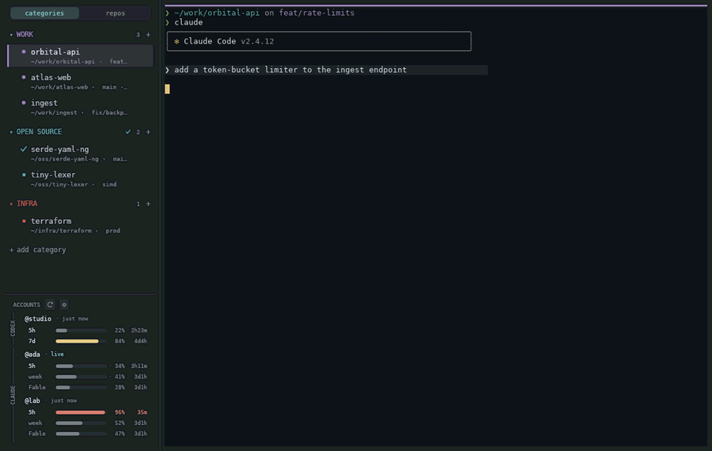

# Giverny

A GPU-rendered terminal for running many Claude Code sessions at once. Tabs sit in categories on a left rail, each tab shows what its Claude is doing, and every account's rate limits are visible in the corner.



Written in Rust on `alacritty_terminal`, with no web engine.

## Features

- **Claude state per tab.** A spinner while Claude works, a flag and desktop notification when it needs input, a ✓ when a background tab finishes. Driven by Claude Code hooks, with a zero-config fallback that reads Claude's local session registry.
- **Multiple accounts.** Each `CLAUDE_CONFIG_DIR` is an account, discovered automatically. Assign one per category; the rail shows 5-hour, weekly and per-model limits with reset times.
- **Persistent sessions.** Tabs, categories, working directories and scrollback survive restarts. Claude conversations resume in the right directory and account. Monitors on the `restore_apps` list (btop, k9s, lazygit) restart; other commands are never re-run.
- **Background agents.** Forked and `run_in_background` sessions appear in the rail. Click one to attach a tab.
- **Rail views.** Group tabs by your own categories or by git repository.
- **Terminal support.** Kitty keyboard protocol (Shift+Enter works in Claude without `/terminal-setup`), kitty graphics, synchronized output, OSC 7 and 52, sanitized bracketed paste, SGR mouse, file drag-and-drop.
- **Right-to-left text.** Hebrew and Arabic render in reading order. Cascadia Mono Hebrew is bundled.
- **Plain config.** `~/.config/giverny/config.toml` hot-reloads. The `Ctrl+,` settings screen writes back to it with comments preserved. See [all options](docs/options.md).
- **`giverny doctor`** prints accounts, hook status, usage freshness and live sessions.

## Install

Linux / macOS:

```sh
curl -fsSL https://github.com/y0av/giverny/releases/latest/download/install.sh | sh
```

Windows:

```powershell
irm https://github.com/y0av/giverny/releases/latest/download/install.ps1 | iex
```

From source (Rust 1.90+):

```sh
git clone https://github.com/y0av/giverny && cd giverny
cargo install --path crates/app
giverny install-desktop
```

`install-desktop` adds the launcher entry and icons. On Linux it also sets `OOMPolicy=continue` on Giverny's systemd scope, so an out-of-memory kill in one tab doesn't close the rest. The install scripts run it for you.

Giverny checks GitHub daily for a new release and offers a one-click update; `giverny update` does the same from a shell. Disable the check with `[update] check = false` or `GIVERNY_NO_UPDATE=1`.

### Platform support

Linux (Wayland and X11) is the primary platform. macOS and Windows build in CI but haven't been tested on real hardware; reports are welcome.

On Windows, Claude accounts inside WSL are discovered and their tabs open in the matching distribution. Under WSLg, an outdated Windows GPU driver makes Giverny fall back to CPU rendering; `GIVERNY_GPU=software` forces that mode.

## Privacy

Giverny never contacts Anthropic and never reads credential files. Usage comes from the `.claude.json` cache Claude Code writes; session state comes from hooks and Claude's session registry. The only network request is the update check, which sends nothing but a User-Agent.

Hook installation shows what it adds, keeps your existing hooks and writes a `.giverny-bak` backup. Pasted text is stripped of escape bytes, and the in-band control channel is nonce-authenticated so terminal output can't fake Claude states. Details in [Claude Code integration](docs/claude-integration.md).

## Keys

| Chord | Action |
|---|---|
| `Ctrl+Shift+T` / `Ctrl+Shift+W` | New tab / close tab |
| `Ctrl+Shift+A` | Next tab where Claude needs you |
| `Ctrl+Shift+P` | Tab palette |
| `Ctrl+Shift+F` | Search scrollback |
| `Ctrl+Shift+E` | Label paths and URLs on screen for quick open |
| `Ctrl+Tab` | Recently used tabs |
| `F2` | Rename tab |
| `Ctrl+,` | Settings |
| `F1` | Full key list |

## Docs

[Architecture](docs/architecture.md) · [Options](docs/options.md) · [Claude Code integration](docs/claude-integration.md) · [Changelog](CHANGELOG.md)

## License

MIT OR Apache-2.0, at your option.

The bundled Cascadia Mono fonts in `crates/term/fonts` are © Microsoft, licensed under the SIL Open Font License 1.1 (`CascadiaMono-OFL.txt`).
