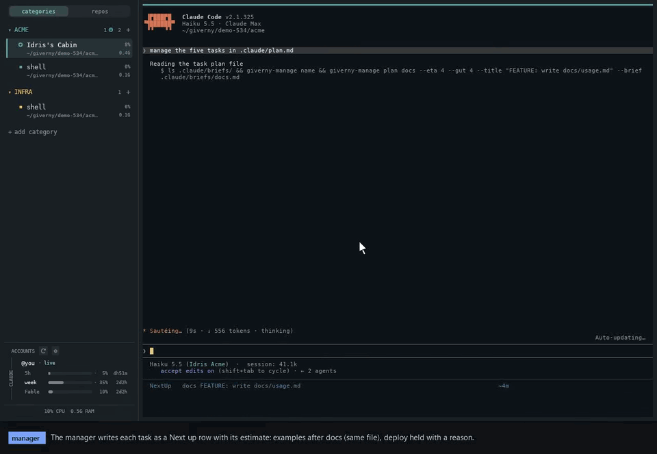
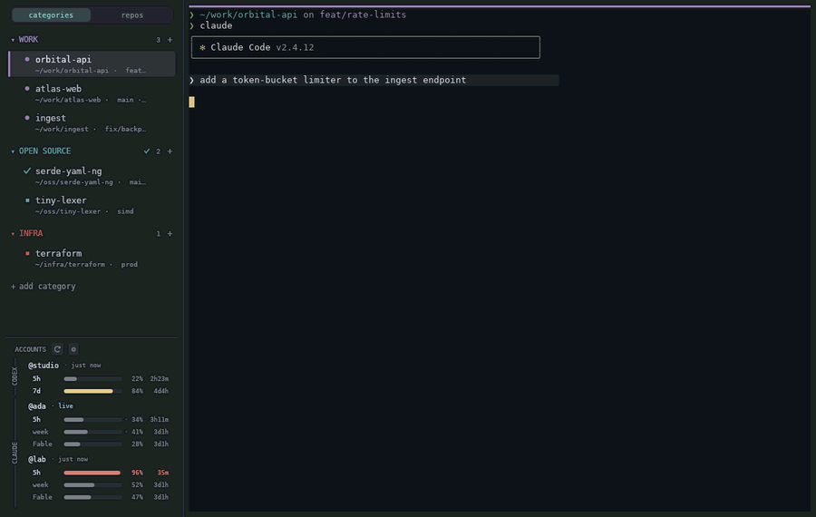

# Giverny: the manager fork

This is the manager fork of Giverny, built on [y0av/giverny](https://github.com/y0av/giverny). It is y0av's Giverny with a manager added: a Claude Code session can run a piece of work as a manager of subagents, one per task, and Giverny shows those tasks in a management panel under the tab. The manager lives on the [`agents-pane`](https://github.com/theitush/giverny/tree/agents-pane) branch; `main` follows y0av's Giverny.



[The full walkthrough](assets/agents-pane-demo.webm) (5 minutes, captioned, WebM) covers everything below.

## What the fork adds

- **`/giverny:manage` and `giverny-manage`.** Giverny carries a Claude Code plugin, `giverny`, written by the app itself (no network, no `claude plugin install`). Its `manage` skill makes the session a manager: it plans the tasks with estimates, spawns one subagent per task and stamps each start and landing with `giverny-manage`. A prompt that asks to "manage" something is sent to it.
- **The management panel.** A table under the tab's terminal. **Next up** rows carry their estimates, and a row can wait for another task to land or be held with a reason. **Running** rows show elapsed time, time left, what the worker is doing now, its tokens, and the CPU and RAM of its `giverny-manage run` commands. **Done** rows show how each task landed against its estimate. Workers re-estimate their own rows, and the manager gets a progress check when one runs past its figure. A click on a Running row opens Claude Code's own view of that worker.
- **A shared RAM ledger.** One ledger for every manager on the machine: a worker's memory is claimed before it starts (granted, granted smaller, queued or refused), and managers in different tabs can ask each other for room. Every Claude tab runs inside one systemd slice capped at the limits in Settings → Management panel, and `giverny-manage run` puts a heavy command in a measured scope of its own.
- **Worker context limits.** A worker carrying more than 200k tokens of context is not handed a next task, and the manager is told when a working worker nears the 450k context cap, in time to wrap it up and hand the rest to a fresh worker. Both are settings.
- **Names for every session** (a setting, off by default). Each Claude session in a tab gets a first name, with its category as surname, shown on its status line and in `/resume`. A tab can be titled after it.
- **Guards.** One manager session cannot kill or stop another's processes or change another's worktree. A command that would leave the cap runs, with a reminder to use `giverny-manage run`. Giverny tells the manager and names the command to run; it stops no worker on its own, and the slice's CPU and memory caps are the only hard limits.

## What it needs

- **Pure WSL.** The management panel and its CPU/RAM figures are supported only in pure WSL: the Linux build, running inside WSL.
- **A build from source.** The in-app **Update** (and `giverny update`) installs y0av's release, which has no manager. Build `agents-pane` instead (Rust 1.90+), and turn the update check off (`[update] check = false` in `~/.config/giverny/config.toml`) so the offer does not replace it:

  ```sh
  git clone -b agents-pane https://github.com/theitush/giverny && cd giverny
  cargo build --release
  target/release/giverny install-desktop
  ```

The panel's own documentation is [docs/management-panel.md](https://github.com/theitush/giverny/blob/agents-pane/docs/management-panel.md); its settings are in [docs/options.md](https://github.com/theitush/giverny/blob/agents-pane/docs/options.md).

---

*The rest of this page is y0av's README for Giverny, the base of this fork.*


# Giverny (upstream)

A native terminal for running Claude Code and Codex sessions side by side, across several accounts at once. Tabs sit in categories on a left rail and show what each agent is doing. Each category can run on its own Claude account, and the rail shows every account's limits with reset times.



Written in Rust on `alacritty_terminal` and rendered on the GPU, with no web engine. Runs on Linux, macOS and Windows.

## Features

- **Multiple accounts.** Each `CLAUDE_CONFIG_DIR` and Codex home is an account, discovered automatically. Claude accounts can be assigned per category, so work and personal projects draw from different plans. The rail shows each account's limits with reset times.
- **Agent state per tab.** A spinner while Claude or Codex works, a flag and desktop notification when it needs input, a ✓ when a background tab finishes. Claude uses Claude Code hooks, with a zero-config fallback to its session registry. Codex uses observer hooks installed from Settings → codex and trusted with `/hooks` ([setup](docs/codex-integration.md)).
- **Background agents.** Forked and `run_in_background` Claude sessions appear in the rail. Click one to attach a tab.
- **Persistent sessions.** Tabs, categories, working directories and scrollback survive restarts. Claude and Codex conversations resume in the right directory and account. Monitors on the `restore_apps` list (btop, k9s, lazygit) restart; other commands are never re-run.
- **Right-to-left text.** Hebrew and Arabic render in reading order. Cascadia Mono Hebrew is bundled.
- **Rail views.** Group tabs by your own categories or by git repository.
- **Terminal support.** Kitty keyboard protocol (Shift+Enter works in Claude without `/terminal-setup`), kitty graphics, synchronized output, OSC 7 and 52, sanitized bracketed paste, SGR mouse, file drag-and-drop.
- **Plain config.** `~/.config/giverny/config.toml` hot-reloads. The `Ctrl+,` settings screen writes back to it with comments preserved. See [all options](docs/options.md).
- **`giverny doctor`** prints Claude and Codex accounts, hook status, usage freshness and live sessions.

## Install

Linux / macOS:

```sh
curl -fsSL https://github.com/y0av/giverny/releases/latest/download/install.sh | sh
```

Windows:

```powershell
irm https://github.com/y0av/giverny/releases/latest/download/install.ps1 | iex
```

From source (Rust 1.90+):

```sh
git clone https://github.com/y0av/giverny && cd giverny
cargo install --path crates/app
giverny install-desktop
```

`install-desktop` adds the launcher entry and icons. On Linux it also sets `OOMPolicy=continue` on Giverny's systemd scope, so an out-of-memory kill in one tab doesn't close the rest. The install scripts run it for you.

Giverny checks GitHub daily for a new release and offers a one-click update; `giverny update` does the same from a shell. Disable the check with `[update] check = false` or `GIVERNY_NO_UPDATE=1`.

### Platform support

Giverny runs on Linux (Wayland and X11), macOS and Windows.

## Privacy

Giverny itself never contacts Anthropic or OpenAI and never reads credential files. Claude usage comes from the `.claude.json` cache Claude Code writes; session state comes from hooks and Claude's session registry. Codex usage comes from the official local `codex app-server` helper, which contacts OpenAI using Codex's own sign-in; it never runs if Codex is disabled in Settings. Giverny's only direct network request is the update check, which sends nothing but a User-Agent.

Hook installation shows what it adds, keeps your existing hooks and writes a `.giverny-bak` backup. Pasted text is stripped of escape bytes, and the in-band control channel is nonce-authenticated so terminal output can't fake agent states. Details in [Claude Code integration](docs/claude-integration.md) and [Codex integration](docs/codex-integration.md).

## Keys

| Chord | Action |
|---|---|
| `Ctrl+Shift+T` / `Ctrl+Shift+W` | New tab / close tab |
| `Ctrl+Shift+A` | Next tab where an agent needs you |
| `Ctrl+Shift+P` | Tab palette |
| `Ctrl+Shift+F` | Search scrollback |
| `Ctrl+Shift+E` | Label paths and URLs on screen for quick open |
| `Ctrl+Tab` | Recently used tabs |
| `F2` | Rename tab |
| `Ctrl+,` | Settings |
| `F1` | Full key list |

## Docs

[Architecture](docs/architecture.md) · [Options](docs/options.md) · [Claude Code integration](docs/claude-integration.md) · [Codex integration](docs/codex-integration.md) · [Changelog](CHANGELOG.md)

## License

MIT OR Apache-2.0, at your option.

The bundled Cascadia Mono fonts in `crates/term/fonts` are © Microsoft, licensed under the SIL Open Font License 1.1 (`CascadiaMono-OFL.txt`).
